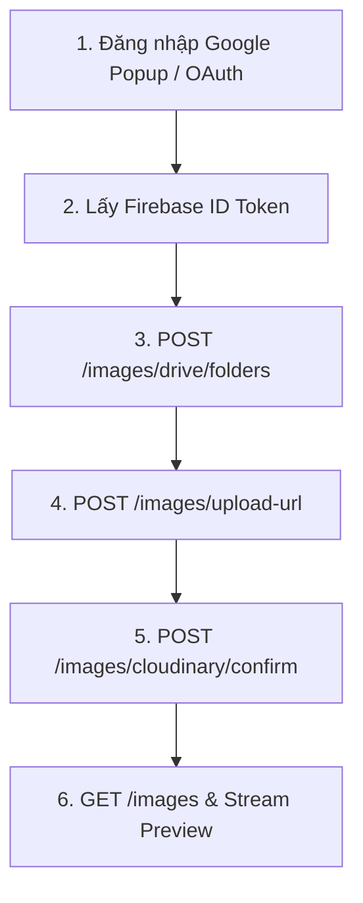

# 🚀 Frontend Test Bench — Image Pipeline & Google Drive Integration

Tài liệu hướng dẫn chi tiết dành cho Frontend Developer để tương tác với **Backend Core (`feat/upload`)**. Hệ thống hỗ trợ xác thực Firebase Authentication, liên kết Google OAuth2 (Google Drive API), quản lý thư mục lưu trữ, đồng bộ pipeline xử lý ảnh đa nền tảng và tích hợp Cloudinary (`UC01`–`UC04`).

---

## 📌 Tổng quan các Tính năng (Key Features)

1. **Firebase Auth & Google OAuth2 Integration:**
   - Đăng nhập Google qua Firebase Client SDK hoặc backend OAuth2 flow để lấy **Firebase Bearer Token** (`Authorization: Bearer <idToken>`).
   - Hỗ trợ liên kết quyền Google Drive (`drive.file`) qua popup, tự động xử lý tín hiệu `postMessage` (`GOOGLE_DRIVE_LINKED`) để đồng bộ phiên làm việc.

2. **Quản lý Thư mục Google Drive & Tự động Đồng bộ (Auto Sync):**
   - Khởi tạo thư mục gốc kèm cấu trúc 3 thư mục con: `upload/`, `processing/`, `processed/`.
   - Quét và ánh xạ tự động metadata của ảnh trên Drive và Cloudinary về chuẩn dữ liệu hệ thống thông qua `imageId`.

3. **Cloudinary Integration Flow (`UC01`–`UC04`):**
   - Đăng ký URL upload (`POST /images/upload-url` & `POST /images/cloudinary/upload-url`).
   - Upload trực tiếp file ảnh hoặc xác nhận upload từ Cloudinary (`POST /images/cloudinary/confirm`).
   - Tự động sinh hoặc làm mới bộ 3 biến thể: `variants.thumbnail`, `variants.medium`, `variants.webp`.

4. **Quản lý Trạng thái Ảnh (Pipeline State Machine):**
   - Giới hạn kích thước file: $S \le 10\text{MB}$.
   - Định dạng hỗ trợ: `.jpg`, `.jpeg`, `.png`, `.webp`.
   - Vòng đời trạng thái ảnh:
     $$\text{upload/} \ (\text{PENDING}) \ \longrightarrow \ \text{processing/} \ (\text{PROCESSING}) \ \longrightarrow \ \text{processed/} \ (\text{DONE / COMPLETED})$$

5. **Phân quyền & Xem trực tiếp (Security & Secure Preview):**
   - Kiểm tra quyền sở hữu ảnh (`ownerId == uid`), trả về lỗi $403 \ \text{Forbidden}$ nếu truy cập trái phép.
   - Stream ảnh trực tiếp từ Google Drive an toàn qua API Proxy: `GET /images/preview/{drive_file_id}?uid=...`.

---

## 📁 Cấu trúc Thư mục Frontend

```text
frontend/
├── index.html       # Single Page Test Bench (HTML5 + Tailwind CSS + ES Modules JS)
└── README.md        # Hướng dẫn khởi chạy và tài liệu cấu hình môi trường
```

---

## ⚙️ Cài đặt và Khởi chạy

### 1. Yêu cầu Tiên quyết
* **Backend Core API:** Đã chạy tại `http://localhost:8000`.
* **Google Cloud Console:** Đã cấu hình Authorized Redirect URI: `http://localhost:8000/oauth/callback`.
* **Firebase Project:** Đã khởi tạo Firebase App với ID `image-processing-project-ea23d` và bật Google Auth Provider.

### 2. Khởi chạy Local Server
Di chuyển vào thư mục `frontend/` và khởi chạy HTTP Server tĩnh:

```bash
cd frontend
python -m http.server 3000
```

Mở trình duyệt tại đường dẫn: **`http://localhost:3000/index.html`**

---

## 🔌 Danh mục API Backend (API Reference)

Tất cả request tới các endpoint dưới đây (trừ `/health` và `/oauth/*`) yêu cầu đính kèm Header:
$$\text{Header: } \texttt{Authorization: Bearer <Firebase\_ID\_Token>}$$

### 1. Phân hệ Xác thực & OAuth2 (Auth & Google OAuth)

| Phương thức | Endpoint | Dynamic Query / Params | Mô tả |
| :--- | :--- | :--- | :--- |
| `GET` | `/health` | Không | Kiểm tra trạng thái hoạt động của Backend server ($200 \ \text{OK}$). |
| `GET` | `/oauth/google/login` | `?uid=...` | Lấy URL đăng nhập Google OAuth2 dưới dạng JSON. |
| `GET` | `/oauth/google/redirect` | `?popup=1` | Chuyển hướng người dùng sang trang đăng nhập Google OAuth2. |

---

### 2. Phân hệ Quản lý Thư mục Google Drive

| Phương thức | Endpoint | Body Payload | Mô tả |
| :--- | :--- | :--- | :--- |
| `POST` | `/images/drive/folders` | `{"folderName": "string", "parentId": "string \| null"}` | Tạo thư mục gốc và khởi tạo 3 thư mục pipeline (`upload`, `processing`, `processed`). |
| `POST` | `/images/sync` | `?folderId=string` | Quét thư mục Drive và Cloudinary để đồng bộ danh sách ảnh mới nhất về DB. |

---

### 3. Phân hệ Upload & Xác nhận Cloudinary (`UC01`–`UC04`)

#### Schema Request: `CloudinaryConfirmPayload`
```json
{
  "imageId": "string",
  "fileName": "string",
  "originalSize": 102400,
  "processedSize": 51200,
  "thumbnailPublicId": "string",
  "mediumPublicId": "string",
  "webpPublicId": "string",
  "processingMs": 145.5,
  "contentType": "image/jpeg"
}
```

#### Chi tiết API Cloudinary

| Phương thức | Endpoint | Payload / Params | Mô tả |
| :--- | :--- | :--- | :--- |
| `POST` | `/images/upload-url` | `{"filename": "str", "contentType": "str", "sizeBytes": int}` | Kiểm tra điều kiện file ($S \le 10\text{MB}$) và sinh mã `imageId` tạm. |
| `POST` | `/images/cloudinary/confirm` | `CloudinaryConfirmPayload` | **UC01 + UC02:** Xác nhận kết quả upload từ Cloudinary và lưu bộ 3 biến thể (`thumbnail`, `medium`, `webp`). |
| `POST` | `/images/cloudinary/{image_id}/process` | Không | **UC02:** Kích hoạt làm mới hoặc tạo lại các biến thể ảnh trên Cloudinary. |
| `GET` | `/images/cloudinary` | Không | **UC04:** Lấy danh sách toàn bộ ảnh Cloudinary của người dùng. |
| `GET` | `/images/cloudinary/{image_id}` | Không | **UC03:** Lấy chi tiết trạng thái và URL các biến thể của một ảnh Cloudinary. |

---

### 4. Phân hệ Truy vấn & Xem trước (Gallery, Status & Preview)

| Phương thức | Endpoint | Params / Payload | Mô tả |
| :--- | :--- | :--- | :--- |
| `GET` | `/images` | `?folderId=string` | **UC04:** Lấy danh sách toàn bộ ảnh thuộc sở hữu của người dùng hiện tại. |
| `GET` | `/images/{image_id}` | Không | **UC03:** Xem chi tiết trạng thái ảnh (Trả về $403$ nếu sai `ownerId`, $404$ nếu không tồn tại). |
| `GET` | `/images/preview/{drive_file_id}` | `?uid=string` | Stream nội dung file ảnh từ Google Drive về trình duyệt dưới dạng Binary Blob. |

---

## 💡 Code Mẫu Tích hợp Frontend (JavaScript ES6 Fetch)

```javascript
const API_BASE = "http://localhost:8000";

// Utility lấy Bearer Token từ Firebase Client SDK
async function getAuthHeaders() {
  const user = firebase.auth().currentUser;
  if (!user) throw new Error("User chưa đăng nhập Firebase.");
  const idToken = await user.getIdToken();
  return {
    "Content-Type": "application/json",
    "Authorization": `Bearer ${idToken}`
  };
}

// 1. Tạo thư mục Pipeline trên Google Drive
async function createDrivePipelineFolder(folderName, parentId = null) {
  const headers = await getAuthHeaders();
  const res = await fetch(`${API_BASE}/images/drive/folders`, {
    method: "POST",
    headers,
    body: JSON.stringify({ folderName, parentId })
  });
  return await res.json();
}

// 2. Xác nhận Upload Cloudinary (Confirm Payload)
async function confirmCloudinary(payload) {
  const headers = await getAuthHeaders();
  const res = await fetch(`${API_BASE}/images/cloudinary/confirm`, {
    method: "POST",
    headers,
    body: JSON.stringify(payload)
  });
  return await res.json();
}

// 3. Load Stream ảnh từ Google Drive
async function loadDriveImagePreview(driveFileId, uid, imgElement) {
  const url = `${API_BASE}/images/preview/${driveFileId}?uid=${encodeURIComponent(uid)}`;
  const res = await fetch(url);
  if (!res.ok) throw new Error(`Lỗi load preview: ${res.status}`);
  const blob = await res.blob();
  imgElement.src = URL.createObjectURL(blob);
}
```

---

## 🧪 Quy trình Kiểm thử Nhanh trên Workbench (Test Workflow)



1. **Bước 1 — Đăng nhập & Xác thực:**
   Bấm **"Đăng nhập Google (Firebase Popup)"** trên `index.html` để nhận `idToken` và `uid`.

2. **Bước 2 — Khởi tạo Google Drive Folder:**
   Nhập tên thư mục (ví dụ: `App_Pipeline`) $\rightarrow$ Bấm **"Tạo Folder & Pipeline"** (`POST /images/drive/folders`).

3. **Bước 3 — Tạo Upload Request:**
   Chọn 1 file ảnh thật $\rightarrow$ Bấm **"POST /images/upload-url"** để lấy `imageId`.

4. **Bước 4 — Confirm Cloudinary:**
   Bấm **"Điền mẫu Confirm"** (tự khớp `imageId` và `CloudinaryConfirmPayload`) $\rightarrow$ Bấm **"POST /images/cloudinary/confirm"**.

5. **Bước 5 — Kiểm tra Gallery & Preview Stream:**
   Bấm **"POST /images/sync"** hoặc **"GET /images"** để xem danh sách ảnh trong gallery, chọn một ảnh và bấm **"Preview Drive Image"** để kiểm tra API Proxy stream.